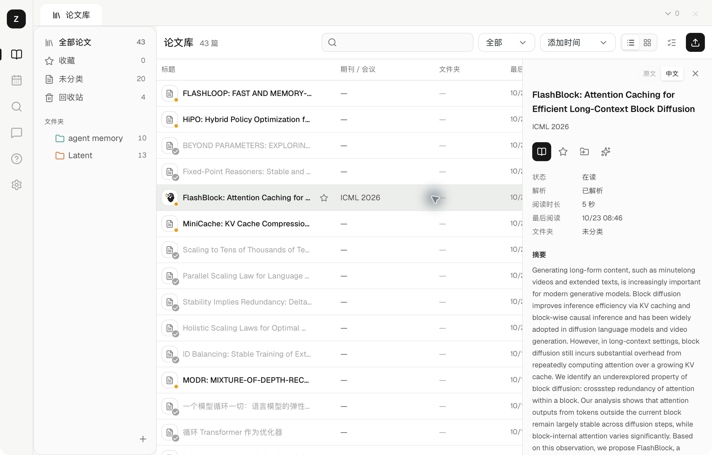
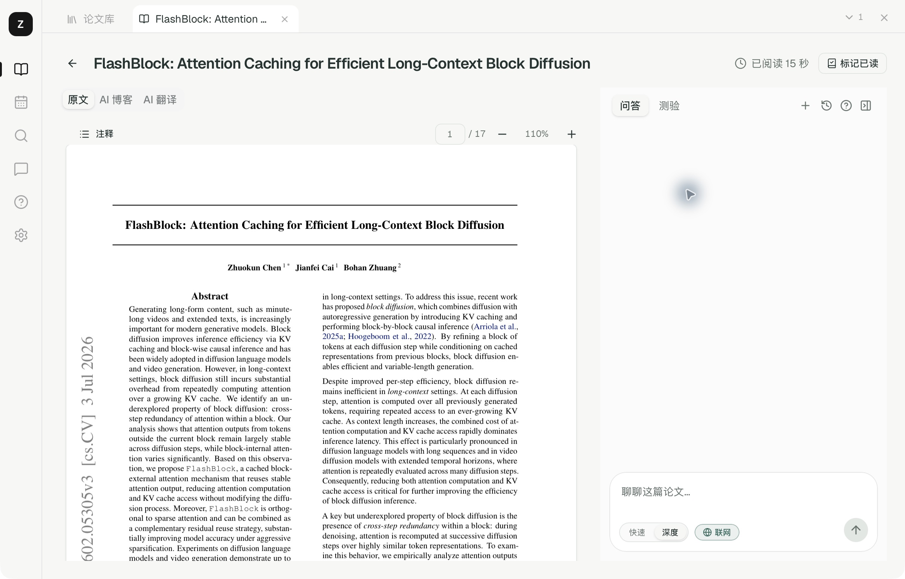
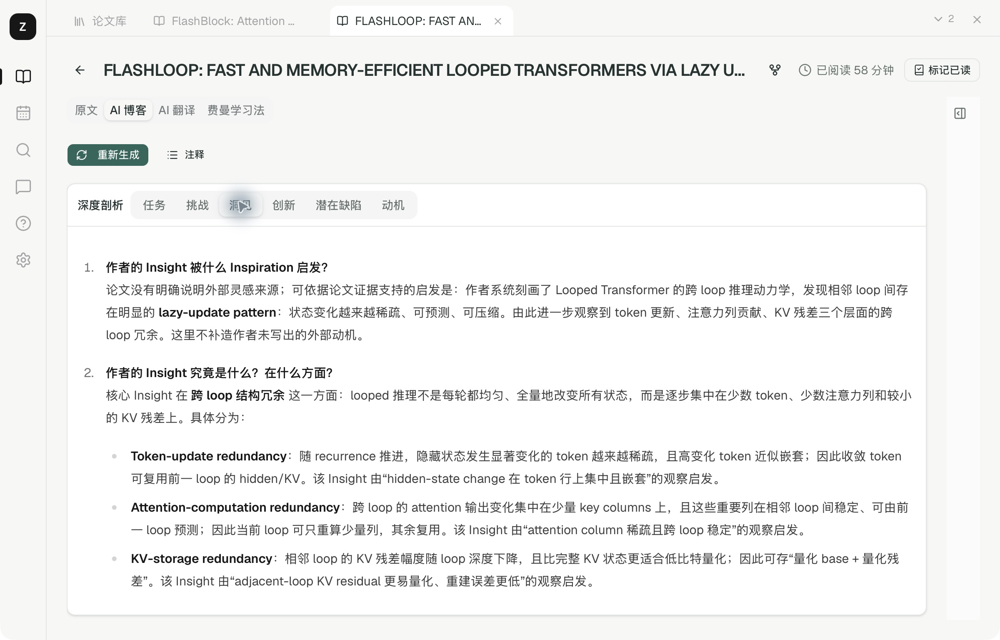
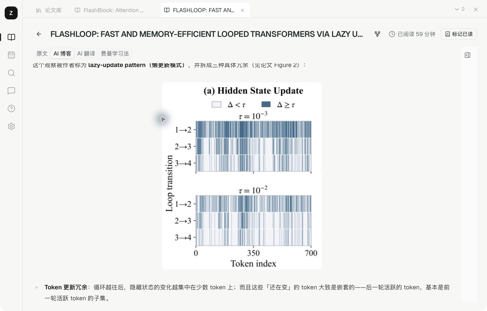
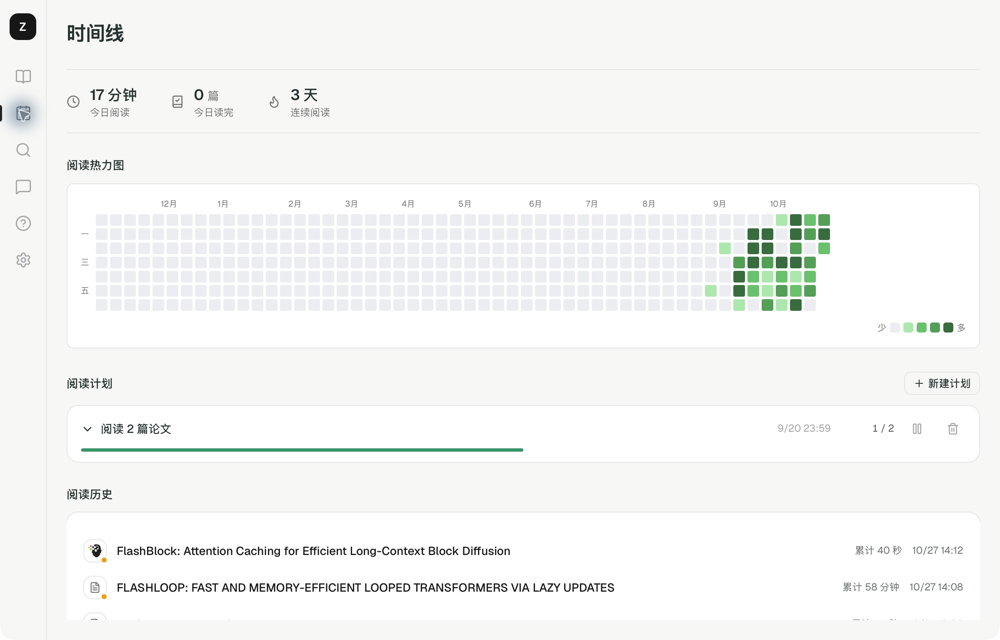

<p align="center">
  
</p>

<h1 align="center">ZoomPaper</h1>

<p align="center">本地优先的论文阅读与知识管理应用</p>

<p align="center">
  <a href="https://github.com/Flutter-Misdreavus/ZoomPaper/releases"></a>
  
  
  <a href="LICENSE"></a>
</p>

<p align="center">
  <a href="https://github.com/Flutter-Misdreavus/ZoomPaper/releases/latest">下载</a> ·
  <a href="#功能">功能</a> ·
  <a href="#安装与配置">安装与配置</a> ·
  <a href="docs/USER_GUIDE.md">使用文档</a> ·
  <a href="#开发与构建">开发与构建</a> ·
  <a href="https://github.com/Flutter-Misdreavus/ZoomPaper/issues">问题反馈</a>
</p>

ZoomPaper 集成 PDF 阅读、论文管理、全文翻译和知识库问答，基于 Tauri、Rust 和 React 构建。论文、标注、索引和会话保存在本机，解析与 AI 功能连接配置的外部服务。

<p align="center">
  
</p>

## 功能

- **论文管理**：嵌套文件夹、多文件夹归属、收藏、阅读状态、列表与卡片视图，支持批量操作和回收站。
- **导入与解析**：本地 PDF 批量导入、浏览器扩展收集、MinerU 后台解析，自动建立索引并通过 DOI 补全出版信息。
- **阅读与标注**：多论文标签、阅读位置恢复、划词翻译、高亮、批注和笔记导出。
- **AI 辅助阅读**：全文翻译、中英对照、AI 博客、论文测验，支持 OpenAI、Anthropic、Gemini、DeepSeek 及兼容接口。
- **检索与问答**：关键词搜索、本地语义检索、单篇与跨论文问答，提供快速和深度模式，回答附带原文引用。
- **阅读记录**：阅读时间线、热力图、阅读计划、桌面阅读伙伴。
- **个性化与数据管理**：主题配色、JSON 高级主题、中英文展示偏好、论文库迁移、备份与恢复。

### 阅读工作区

原文 PDF、AI 翻译和 AI 博客在同一工作区切换，右侧面板提供问答与测验。PDF、译文和博客均支持选文高亮、批注、翻译和提问。

<p align="center">
  
</p>

论文标签支持拖动排序、搜索切换、关闭撤销和重启恢复。全文翻译与博客生成在切换论文后继续运行，结果按论文保存；完整退出应用会停止未完成的请求。

### AI 博客

根据论文正文生成中文解读，包含背景、方法、实验与局限分析。深度剖析面板按任务、挑战、洞见、创新、潜在缺陷和动机分类展示，正文支持图表、公式与标注。

<p align="center">
  
</p>

<details>
<summary>博客正文与论文图表</summary>

<p align="center">
  
</p>

</details>

### 知识库问答

阅读器内的问答以当前论文为范围，知识库问答支持跨论文检索。回答中的论文引用可跳转到对应原文位置。

| 模式 | 执行方式 |
| --- | --- |
| 快速 | 单轮检索后生成回答 |
| 深度 | 多轮调用语义检索、章节精读、标注与译文等工具，可向用户澄清，并展示工具执行过程 |

深度模式支持联网检索，当前使用 DeepSeek / Anthropic 的原生搜索能力，需配置相应服务。思考内容、工具状态和回答以流式更新。

### 浏览器扩展

ZoomPaper Connector 支持 Chrome 和 Edge，可从论文详情页或 PDF 链接发起导入。扩展通过浏览器下载全文，沿用当前登录与网络环境；应用确认保存后返回回执，正文解析进入后台队列。

支持 arXiv、OpenReview、ACL Anthology 等来源的元数据与全文链接识别。下载失败时提供候选全文地址、手动输入链接和重试入口。具体范围与限制见 [浏览器导入说明](docs/BROWSER-SUPPORT.md)，安装与更新见 [Connector 文档](browser-extension/README.md)。

### 阅读时间线

记录阅读时长、完成状态和阅读历史，提供年度热力图、每日目标与论文清单计划。

<p align="center">
  
</p>

桌面阅读伙伴显示阅读与后台任务气泡，提供导入论文、继续阅读入口，可在设置中切换或隐藏。

<p align="center">
  
</p>

<sub>截图来自本地运行的开发版，界面可能与发布版本有所差异。论文内容版权归原作者所有。</sub>

## 安装与配置

### 安装

[下载最新版本](https://github.com/Flutter-Misdreavus/ZoomPaper/releases/latest)

当前仓库的自动发布工作流提供 **macOS Apple Silicon（M 系列芯片）** 的 `.dmg` 安装包。下载后打开，将 ZoomPaper 拖入「应用程序」。其他平台的安装包以 Release 实际附件为准。

<details>
<summary>macOS 首次打开提示与命令行安装</summary>

未公证版本首次打开时，可在「系统设置 → 隐私与安全性」中允许打开。若提示「已损坏」，请先确认安装包来自本仓库的 Releases；该提示也可能与隔离标记或签名有关，并不能单凭提示判断文件是否损坏。

确认来源后，可移除该应用的隔离标记再尝试打开：

```sh
xattr -dr com.apple.quarantine /Applications/ZoomPaper.app
```

也可使用仓库安装脚本（macOS，有对应架构安装包时可用）：

```sh
curl -fsSL https://raw.githubusercontent.com/Flutter-Misdreavus/ZoomPaper/main/install.sh | sh
```

脚本会下载匹配架构的安装包、安装到 `/Applications` 并移除隔离标记；已安装相同版本时跳过。

</details>

### 服务配置

在「设置」中配置解析和模型服务：

| 服务 | 用途 | 配置说明 |
| --- | --- | --- |
| MinerU | PDF 转为结构化 Markdown | 正文解析，以及依赖解析内容的检索与 AI 功能 |
| OpenAI / Anthropic / Gemini / DeepSeek 或兼容接口 | 问答、翻译、博客、测验 | 使用 AI 功能时任选可用配置 |
| 本地 Embedding 模型 | 建立向量索引、语义检索 | 首次使用需下载模型，之后在本机推理 |

PDF 保存后即可打开原文，后台解析完成后再使用正文检索和相关 AI 功能。API 调用费用由所选服务商收取。

### 导入与阅读

1. 点击论文库右上角的**上传图标**，选择一个或多个 PDF；也可以使用浏览器扩展导入。
2. 双击论文打开阅读工作区，选中文字可执行翻译、标注或提问。
3. 在工作区切换原文、AI 翻译或 AI 博客；右侧面板提供问答与测验。

操作说明见 [使用文档](docs/USER_GUIDE.md)，应用内「帮助」提供同一份功能手册。

## 数据与存储

ZoomPaper 无需应用账号。论文文件、解析结果、向量索引、阅读记录、标注和会话保存在本机。

PDF 解析将文件发送至 MinerU；AI 功能将请求与所需上下文发送至配置的模型服务；DOI 补全向 Crossref / DataCite 查询 DOI。语义检索使用本地 Embedding 模型和 SQLite 向量索引，首次运行需下载模型。

默认数据目录：

- macOS：`~/Library/Application Support/com.paper-reader/`
- Windows：`%APPDATA%\com.paper-reader\`（使用 `dirs::data_dir()` 定位）

```text
com.paper-reader/
├── database.sqlite       # 论文元数据、向量索引、会话等
├── settings.json         # API 密钥与配置
└── papers/               # 可在设置中迁移论文库位置
    └── {uuid}/
        ├── paper.pdf     # 原始论文
        ├── paper.md      # 结构化正文
        ├── images/       # 解析图片
        ├── blog.md       # 已生成的博客
        ├── annotations.json
        └── translation.json
```

「设置 → 数据与存储」提供完整备份与恢复：备份包含论文与生成内容、会话、标注和界面偏好，**不包含 API 密钥**。恢复通过校验后在重启时生效，保留当前 API 配置；操作前请等待后台任务完成。`settings.json` 中的密钥以本地明文保存，请妥善保管。

## 开发与构建

桌面端基于 **Tauri v2 + Rust + React 19 + TypeScript**，使用 Tailwind CSS v4、Base UI 与 Motion 构建界面。

在 macOS 上开发需准备 **Node.js 20.19+ 或 22.12+**、Rust stable 和 Xcode Command Line Tools（`xcode-select --install`）。其他平台需安装对应的 Tauri 系统依赖；当前发布工作流验证的打包目标为 Apple Silicon macOS。

```bash
git clone https://github.com/Flutter-Misdreavus/ZoomPaper.git
cd ZoomPaper
npm ci

npm run tauri dev       # 启动桌面开发环境
npm run test            # 前端测试
npm run tauri build     # 构建桌面安装包
```

构建产物在 `src-tauri/target/release/bundle/`；指定 target 构建时位于对应 target 子目录。浏览器扩展可通过 `npm run package:extension` 打包，详见 [扩展开发说明](browser-extension/README.md)。

### 技术架构


| 模块 | 实现与入口 |
| --- | --- |
| 论文工作区 | `src/components/PaperWorkspace.tsx`：论文库与多标签阅读 |
| 阅读与 AI 界面 | `src/pages/Reader.tsx`、`AskPage.tsx`：原文、翻译与问答 |
| 桌面命令 | `src-tauri/src/commands.rs` + `lib.rs`：前后端通信与注册 |
| 深度问答 | `src-tauri/src/agent/`：执行循环、工具注册与调用 |
| 模型与解析服务 | `src-tauri/src/ai/`：多 Provider LLM、Embedding、MinerU |
| 检索与存储 | `src-tauri/src/rag/` + `db/`：fastembed、SQLite、sqlite-vec（384 维） |

发布流程、Developer ID 签名与公证配置见 [发布说明](docs/RELEASING.md)。

## 贡献

通过 [Issues](https://github.com/Flutter-Misdreavus/ZoomPaper/issues) 提交问题或功能建议，通过 Pull Request 提交代码变更。问题报告请包含系统、应用版本和复现步骤。

## 许可证

[MIT](LICENSE) · Copyright 2025 Flutter-Misdreavus
